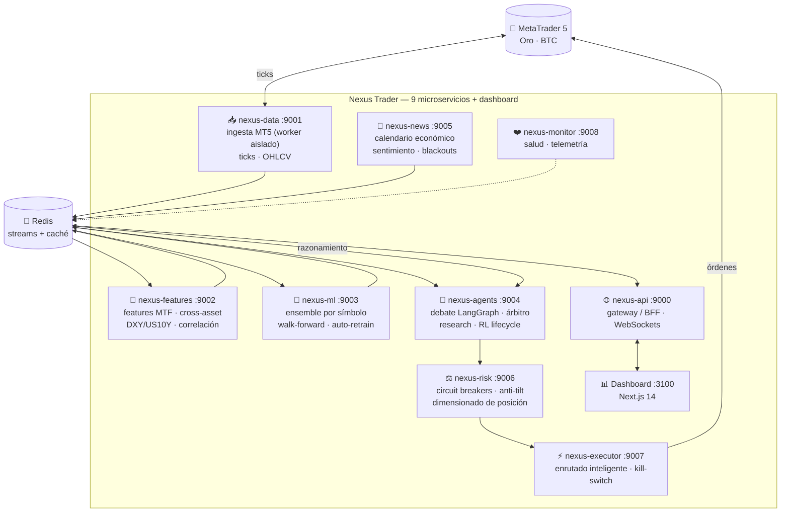
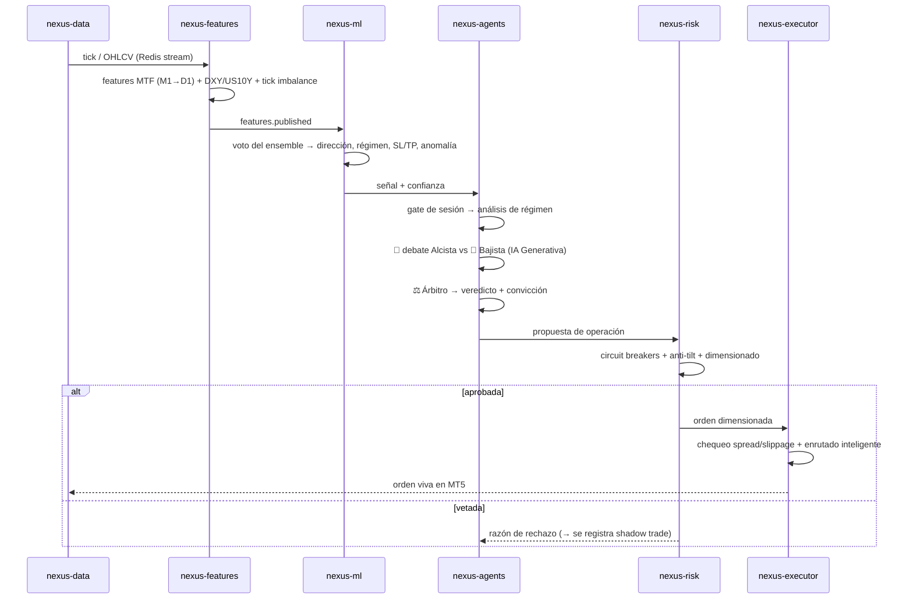
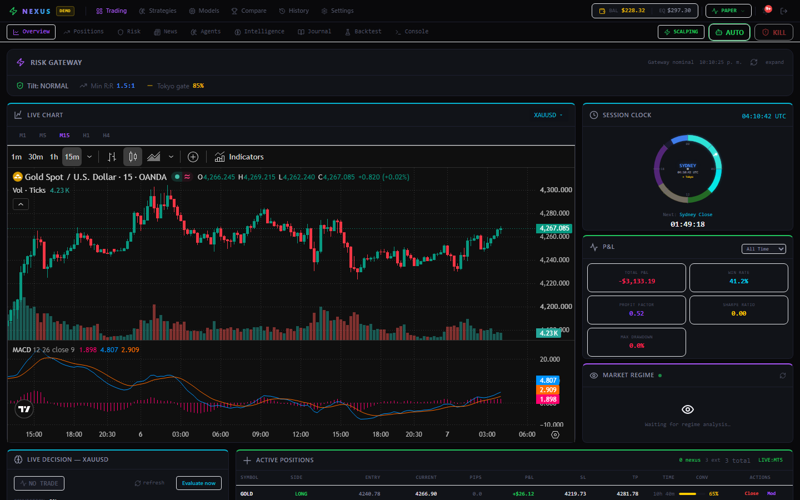
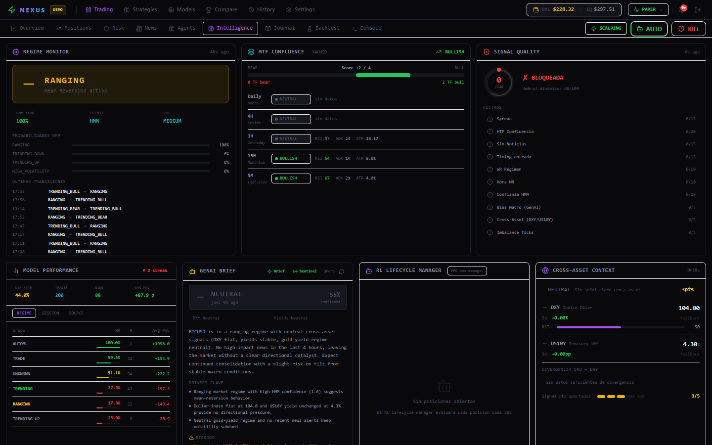
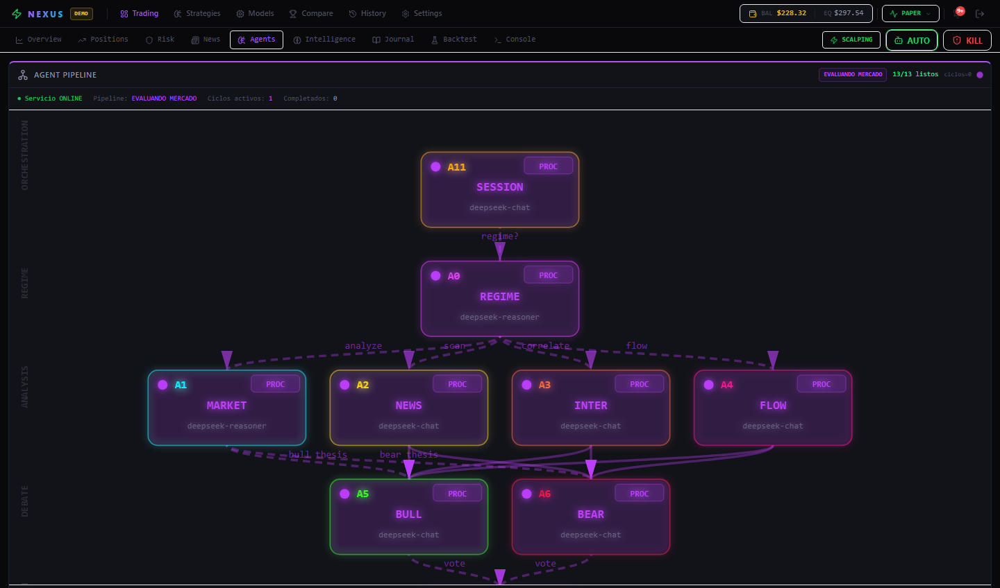
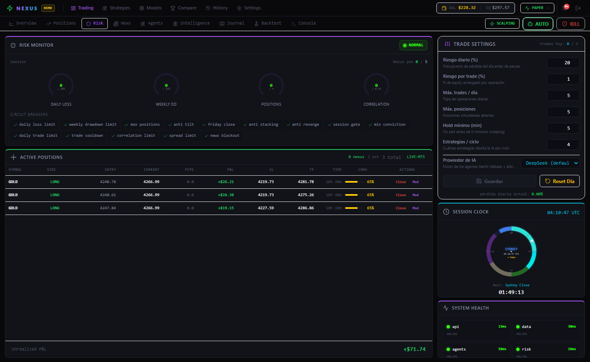
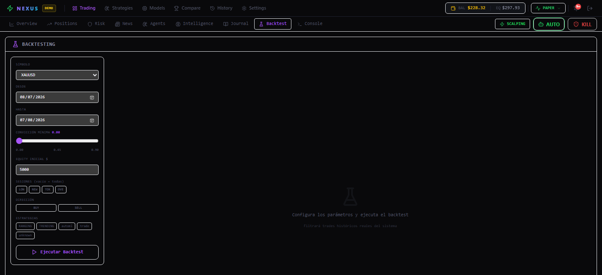

<div align="center">

# 🛰️ Nexus Trader — MT5

### Sistema de **trading con IA** autónomo y multi-agente para **XAUUSD (Oro)** y **BTCUSD** en MetaTrader 5

**Un motor de 9 microservicios que fusiona un ensemble cuantitativo de ML, un debate multi-agente de IA Generativa, aprendizaje por refuerzo y un gestor de riesgo conductual en vivo — razonando sobre la estructura real del mercado y ejecutando en MT5.**

📄 [**English**](README.md) &nbsp;·&nbsp; ⚖️ AGPL-3.0 &nbsp;·&nbsp; 🐍 Python 3.11+ &nbsp;·&nbsp; ⚛️ Next.js 14


</div>

---

> ⚠️ **Aviso.** Este es un proyecto de investigación y portafolio. Operar instrumentos apalancados (Oro, CFDs de cripto) implica un riesgo sustancial de pérdida. El repositorio **no incluye credenciales** y se conecta a una cuenta **demo** por defecto. Nada aquí es asesoría financiera. Úsalo bajo tu propio riesgo.

---

## 📚 Documentación

| Guía | Contenido |
|------|-----------|
| **[README en Inglés](README.md)** | Arquitectura, stack de IA, cómo opera, instalación |
| **[📖 Guía de instalación](docs/SETUP.es.md)** | Instalación paso a paso, configuración y solución de problemas |
| **[Este README](README.es.md)** | Traducción completa al español |
| **[.env.example](.env.example)** | Cada parámetro de configuración, documentado |

---

## 🎯 Qué es realmente

Nexus Trader es un **cerebro de trading totalmente autónomo** construido como **9 microservicios cooperativos**. No corre una sola estrategia de indicadores — corre un *pipeline de especialistas* que discuten hasta llegar a una decisión, igual que una mesa de trading real:

1. **Mesa cuantitativa** — un ensemble de machine learning (gradient boosting + modelos secuenciales profundos + detección de anomalías) vota dirección, régimen de volatilidad y SL/TP.
2. **Mesa de research** — agentes de IA Generativa (un *alcista* y un *bajista*) debaten la operación, y un agente **árbitro** emite el veredicto con un score de convicción.
3. **Mesa de riesgo** — un motor de reglas en vivo + guardia conductual *anti-tilt* dimensiona la posición y puede vetar cualquier cosa, sin importar cuán segura esté la mesa.
4. **Mesa de ejecución** — un enrutador inteligente coloca la orden en MT5 con control de slippage/spread y un kill-switch global.

Todo es **orientado a eventos sobre Redis streams**, **configurado dinámicamente** (sin números mágicos hardcodeados — los límites viven en Redis y se editan desde el dashboard) y **multi-símbolo** (modelos ML separados por símbolo: el Oro no se comporta como Bitcoin).

---

## 🧠 Las dos capas de IA (y por qué son dos)

La mayoría de los "bots de IA" son un solo modelo. Nexus apila deliberadamente **dos tipos de inteligencia complementarios**, porque fallan de formas distintas:

```mermaid
flowchart LR
    subgraph Q["🔢 IA Cuantitativa  ·  rápida, numérica, backtesteable"]
        direction TB
        Q1[XGBoost — dirección]
        Q2[LightGBM — régimen + SL/TP]
        Q3[LSTM — memoria secuencial]
        Q4[Isolation Forest — anomalías]
        Q5[HMM — estados de régimen ocultos]
    end
    subgraph G["💬 IA Generativa  ·  razonamiento contextual + narrativa"]
        direction TB
        G1[Investigador Alcista]
        G2[Investigador Bajista]
        G3[Árbitro — veredicto final]
        G4[News Sentinel + FinBERT]
    end
    Q -->|votos numéricos + confianza| G
    G -->|veredicto razonado + convicción| R[⚖️ Gestor de Riesgo]
    R --> E[⚡ Ejecutor → MT5]
```



- La **IA Cuantitativa** es precisa y backtesteable pero ciega al contexto (no puede leer un titular de un banco central).
- La **IA Generativa** lee contexto, pondera evidencia contradictoria y *se explica a sí misma* — pero alucina y no mide probabilidades.
- El **árbitro** fusiona ambas, y el **gestor de riesgo** tiene el veto final e inapelable.

---

## 🏗️ Arquitectura del sistema



Los servicios nunca se llaman entre sí directamente para datos de mercado — **publican y se suscriben a Redis streams**, así cualquier servicio puede caerse y reiniciar sin tumbar el pipeline. `run.py` es un supervisor que arranca los 9 servicios + el dashboard, inyecta las URLs inter-servicio y reinicia las caídas automáticamente.

---

## 🔄 Cómo se toma una operación (el ciclo de decisión)



El pipeline de agentes LangGraph ejecuta estos nodos en orden:
`session_check → regime_analysis → parallel_analysis → parallel_debate → arbitrator → risk_check → execute → position_manage → portfolio_review`.

---

## 🔬 Técnicas de frontera utilizadas (el "conocimiento de valor")

Aquí es donde lo cuantitativo se encuentra con el ML moderno. Nexus combina, en un solo sistema:

| Técnica | Dónde | Por qué importa |
|---------|-------|-----------------|
| **Fusión multi-timeframe** | features | M1→D1 aplanados en un solo vector: el modelo ve micro + macro a la vez |
| **Detección de régimen de volatilidad** | HMM + LightGBM | La estrategia se adapta a *tendencia / rango / alta-vol* en vez de talla única |
| **Señales cross-asset** | features | El Oro se cotiza contra el **DXY** (USD) y los rendimientos reales **US10Y**; BTC vs apetito de riesgo |
| **Ensemble con gradient boosting** | XGBoost + LightGBM | Dirección + regresión de SL/TP, por símbolo, validado walk-forward |
| **Memoria secuencial profunda** | LSTM (PyTorch) | Captura dependencia de trayectoria que un árbol no puede |
| **Detección de anomalías** | Isolation Forest | Marca estados anómalos del mercado → suprime el trading |
| **Debate multi-agente GenAI** | LangGraph + DeepSeek | Razonamiento adversarial alcista/bajista + un árbitro que debe justificar el veredicto |
| **Sentimiento de noticias** | FinBERT + LLM | Scoring de impacto del calendario económico y **ventanas de blackout** pre-noticia |
| **Aprendizaje por refuerzo** | PPO (PyTorch) | Un agente de *ciclo de vida* gestiona cada posición abierta bar-by-bar — mantener / trailing / mover a breakeven / cierre parcial / salir |
| **I+D autónoma de estrategias** | research registry | La GenAI propone estrategias; se backtestean y se promueven/retiran por umbrales basados en reglas |
| **Riesgo conductual** | motor anti-tilt | Guardias de pérdidas consecutivas y revenge-trading — la capa psicológica que casi ningún bot tiene |
| **Shadow trades** | risk + memory | Las señales rechazadas se registran contrafácticamente para medir el costo de la cautela |
| **Memoria de trades** | DuckDB | Win-rates por hora / sesión / régimen alimentan umbrales *dinámicos* |
| **Walk-forward + auto-retrain** | nexus-ml | Los modelos se reentrenan con datos frescos y nunca miran al futuro |

---

## 🤖 El ensemble de ML (nexus-ml)

Cada **símbolo** mantiene sus propios modelos entrenados en `models_store/<SYMBOL>/` — el Oro y Bitcoin tienen cerebros completamente separados.

| Modelo | Archivo | Rol |
|--------|---------|-----|
| **XGBoost** | `xgboost_direction.py` | Clasificador principal SUBE/BAJA con probabilidad calibrada |
| **LightGBM** | `lightgbm_regime.py` | Clase de régimen de volatilidad + regresión de SL/TP en pips |
| **LSTM** | `lstm_sequence.py` | Modelo secuencial para momentum dependiente de trayectoria |
| **Random Forest** | `random_forest_features.py` | Importancia de features y voto de robustez |
| **Isolation Forest** | `isolation_anomaly.py` | Detector no supervisado de anomalías / ruptura de régimen |
| **HMM** | `hmm_regime.py` | Etiquetado de régimen por estados ocultos de Markov |
| **FinBERT** | `finbert_sentiment.py` | Scoring de sentimiento de noticias con transformer |

Los votos se agregan en `ensemble.py`; `auto_retrain.py` agenda el reentrenamiento; `trade_memory.py` (DuckDB) provee el contexto adaptativo.

---

## 🧑‍💼 La mesa de agentes (nexus-agents)

Una máquina de estados LangGraph de agentes especialistas (IA Generativa vía **DeepSeek**, compatible con OpenAI):

| Agente | Rol |
|--------|-----|
| **Session Governor** | ¿Es operable esta sesión (Tokio/Londres/NY/Sídney)? Se adapta, nunca bloquea en seco |
| **Regime Analyst** | Clasifica el régimen actual del mercado para el debate |
| **Market Analyst / Order Flow / Intermarket** | Leen estructura, flujo y contexto cross-asset |
| 🐂 **Investigador Alcista** vs 🐻 **Investigador Bajista** | Debate adversarial — cada uno defiende su lado |
| ⚖️ **Árbitro (A7)** | Veredicto final + score de convicción, debe justificarlo |
| 🛡️ **Gestor de Riesgo (A8)** | Veto inapelable + dimensionado |
| **Portfolio Strategist / Position Manager** | Coherencia a nivel portafolio y gestión de trades abiertos |
| **News Sentinel** | Impacto del calendario económico + ventanas de blackout |

El módulo de **Research** (`research/researcher.py`, `evaluator.py`, `registry.py`) propone, backtestea y promueve/retira estrategias de forma autónoma mediante **umbrales basados en reglas** (estados: active / backtested / investigating / rejected). Por separado, un **agente PPO de ciclo de vida** (`nexus_ml/traders/rl_lifecycle.py`, PyTorch) gestiona cada *posición abierta* bar-by-bar — mantener, trailing, mover a breakeven, cierre parcial o salir.

---

## ⚖️ El sistema de riesgo (nexus-risk) — lo que te mantiene solvente

El riesgo es un **servicio de primera clase**, no un añadido. Los límites son **mínimos inviolables** fijados en código y **editables en vivo** por encima de eso desde el dashboard.

- **Circuit breakers**: pérdida diaria (por defecto **20%**), drawdown semanal (**25%**), máx. posiciones, tope de correlación, tope de trades diarios, convicción mínima, risk:reward mínimo.
- **Motor anti-tilt**: rastrea pérdidas consecutivas, impone cooldowns y bloquea el *revenge trading* y el *apilamiento* en la misma dirección.
- **Contabilidad solo-Nexus**: en una cuenta MT5 compartida, solo las operaciones colocadas por Nexus cuentan para sus límites — los trades externos/manuales nunca disparan el breaker.
- **Dimensionado dinámico**: los lotes escalan desde el equity (con techo duro); BTC usa lote fijo.
- **Kill-switch global**: el ejecutor lo revisa antes de cada orden.

---

## 📊 Dashboard

Una sala de control en tiempo real en **Next.js 14** (pestañas: *Overview, Positions, Risk, News, Agents, Intelligence, Journal, Backtest, Console*) transmitiendo por WebSockets + SSE: reloj de sesión en vivo, estado del pipeline de ML, el razonamiento del árbitro A7, el monitor de riesgo con cada circuit breaker, matriz de correlación, panel cross-asset y un runner de backtest.

**Overview** — P&L en vivo, régimen de mercado, la decisión A7 con convicción, reloj de sesión y posiciones abiertas:


**Intelligence** — los votos del ensemble ML, el debate alcista/bajista, cross-asset, matriz de correlación y el ciclo de vida de estrategias PPO:


**Agents** — el pipeline LangGraph, el razonamiento alcista vs bajista y el veredicto del árbitro:


**Monitor de Riesgo** — cada circuit breaker, los gauges de pérdida diaria (20%) y drawdown, anti-tilt y dimensionado dinámico:


**Backtest** — un backtest de filtro de parámetros sobre tus trades cerrados históricos (WR, PF, Sharpe, max drawdown) con curva de P&L acumulado:


---

## 🧰 Stack tecnológico

**Backend** · Python 3.11+ · FastAPI · Pydantic v2 · Redis (streams + caché) · DuckDB
**ML/IA** · XGBoost · LightGBM · PyTorch (LSTM + PPO propio) · scikit-learn · hmmlearn · LangChain / LangGraph · **DeepSeek / OpenAI (GPT) / Gemini** (seleccionable) · FinBERT
**Mercado** · MetaTrader5 · pandas-ta
**Frontend** · Next.js 14 (App Router) · React · TypeScript · Tailwind · TanStack Query · WebSockets/SSE
**Infra** · Redis (Docker) · un supervisor en Python (`run.py`) que arranca y sana toda la flota

---

## ✅ Requisitos

- **Python 3.11+** y un entorno virtual
- **Node.js 18+** (dashboard)
- **Docker Desktop** (para Redis) — o un Redis local en `:6379`
- Terminal de **MetaTrader 5** instalado y con sesión iniciada (una cuenta **demo** es perfecta)
- Opcional: una API key de **DeepSeek** para los agentes GenAI (el ensemble cuantitativo funciona sin ella)

---

## 🚀 Instalación y ejecución

```bash
# 1. Clonar
git clone https://github.com/MirandaCR/Nexus-Trading-System-MT5.git
cd Nexus-Trading-System-MT5

# 2. Entorno Python + dependencias
python -m venv .venv
# Windows: .venv\Scripts\activate   ·   macOS/Linux: source .venv/bin/activate
pip install -r requirements.txt

# 3. Dependencias del dashboard
cd dashboard && npm install && cd ..

# 4. Configuración — copia la plantilla y pon TUS valores
cp .env.example .env
#   → define MT5_LOGIN / MT5_PASSWORD / MT5_SERVER (cuenta demo)
#   → opcional: DEEPSEEK_API_KEY para los agentes GenAI

# 5. Levanta Redis (Docker)
docker run -d --name nexus-redis -p 6379:6379 redis:7-alpine

# 6. Arranca toda la flota (9 servicios + dashboard) con chequeos pre-vuelo
python run.py
```

Luego abre **http://localhost:3100**. `run.py` corre un pre-flight (entorno, Redis, conectividad MT5, modelos) y se niega a arrancar si falta algo crítico.

---

## ⚙️ Configuración

Todo se maneja desde `.env` (ve **[.env.example](.env.example)** para la lista completa documentada). Lo esencial:

| Variable | Significado |
|----------|-------------|
| `MT5_LOGIN` / `MT5_PASSWORD` / `MT5_SERVER` | Tus credenciales MT5 **demo** (nunca las subas) |
| `STREAM_SYMBOLS` | Símbolos a operar, p. ej. `XAUUSD,BTCUSD` |
| `NEXUS_TRADING_MODE` | Comportamiento `live` / paper |
| `NEXUS_LLM_PROVIDER` | **Qué IA usan los agentes** — `deepseek` (default), `openai` (GPT), `gemini` o `local` |
| `DEEPSEEK_API_KEY` / `OPENAI_API_KEY` / `GEMINI_API_KEY` | Key del proveedor elegido (solo se necesita una) |
| `NEXUS_FIXED_LOTS` | Lote fijo por símbolo (p. ej. `BTCUSD=0.02`) |
| `NEXUS_LOG_JSON` | `false` = logs legibles en consola, `true` = JSON para prod |

> 🧠 **Elige tu IA.** Los agentes GenAI corren en **DeepSeek** por defecto, pero puedes cambiar a **OpenAI (GPT)** o **Google Gemini** con una sola variable de entorno — los tres usan endpoints compatibles con OpenAI, sin dependencias extra. El ensemble cuantitativo de ML funciona con cualquier proveedor.

Los límites de riesgo en runtime (pérdida diaria, posiciones, convicción…) viven en **Redis** y se editan desde **Settings** del dashboard — sin redeploy.

---

## 🗂️ Estructura del proyecto

```
nexus-trader/
├── run.py                 # supervisor: arranca y sana todos los servicios + dashboard
├── preflight.py           # chequeos de seguridad al arrancar
├── config/                # risk_rules.yaml + configs de estrategia
├── shared/                # modelos, cliente Redis, logger, settings de runtime
├── services/
│   ├── nexus_api/         # gateway / BFF + WebSockets  (:9000)
│   ├── nexus_data/        # ingesta MT5 (worker aislado) (:9001)
│   ├── nexus_features/    # MTF + cross-asset + correlación (:9002)
│   ├── nexus_ml/          # ensemble, modelos, traders, RL (:9003)
│   ├── nexus_agents/      # agentes LangGraph, research, RL lifecycle (:9004)
│   ├── nexus_news/        # calendario + sentimiento (:9005)
│   ├── nexus_risk/        # circuit breakers + anti-tilt (:9006)
│   ├── nexus_executor/    # ejecución MT5 + kill-switch (:9007)
│   └── nexus_monitor/     # salud + telemetría (:9008)
├── dashboard/             # sala de control Next.js 14 (:3100)
├── models_store/          # modelos entrenados por símbolo (git-ignored)
└── docs/                  # documentación + capturas
```

---

## ⚠️ Limitaciones honestas

- El P&L en vivo depende de un **terminal MT5 corriendo, con sesión iniciada** y *Algo Trading* activado.
- Los agentes GenAI necesitan una key de DeepSeek; sin ella el sistema igual opera con el ensemble cuantitativo.
- Los modelos ML se reentrenan con tus datos — los pesos de fábrica son un punto de partida, no una garantía.
- Este es un sistema de **portafolio / investigación**, no una máquina de imprimir dinero. Los mercados cambian; rendimiento pasado ≠ resultados futuros.

---

## 🤝 Contribuir

Issues y PRs bienvenidos. Al ser **AGPL-3.0**, cualquier versión hosteada/derivada también debe publicar su código fuente.

## ⚖️ Licencia

Bajo la **GNU Affero General Public License v3.0** — ver [LICENSE](LICENSE).
La cláusula de red de la AGPL implica que si corres una versión modificada como servicio, debes ofrecer su código fuente a tus usuarios.

---

<div align="center">

*Construido como proyecto de portafolio por [@MirandaCR](https://github.com/MirandaCR) — combinando finanzas cuantitativas, ML moderno e IA Generativa aplicada.*

</div>
