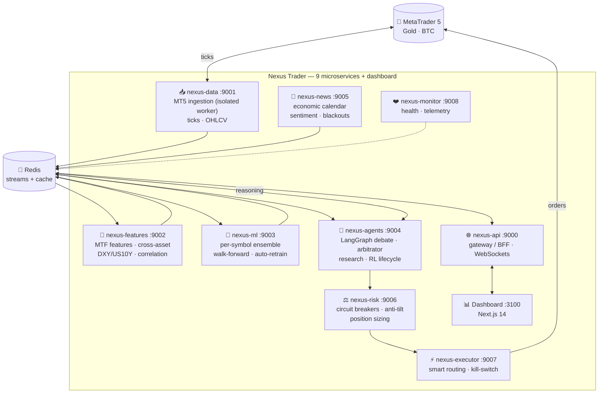
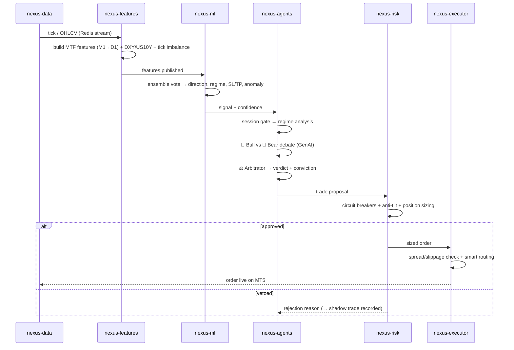
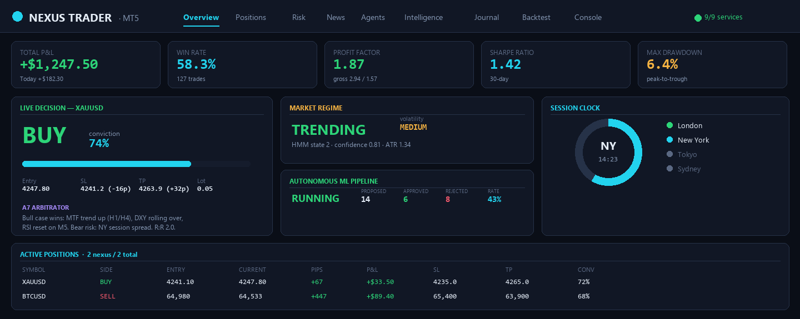
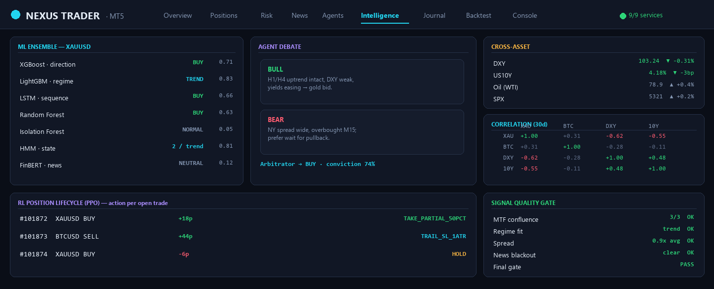
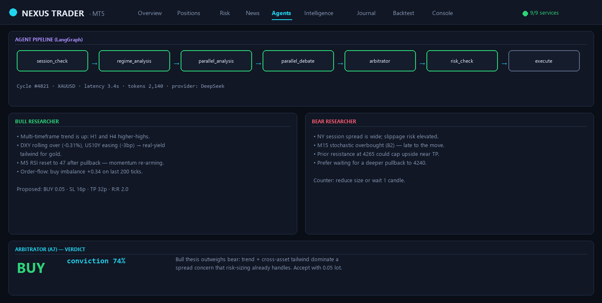
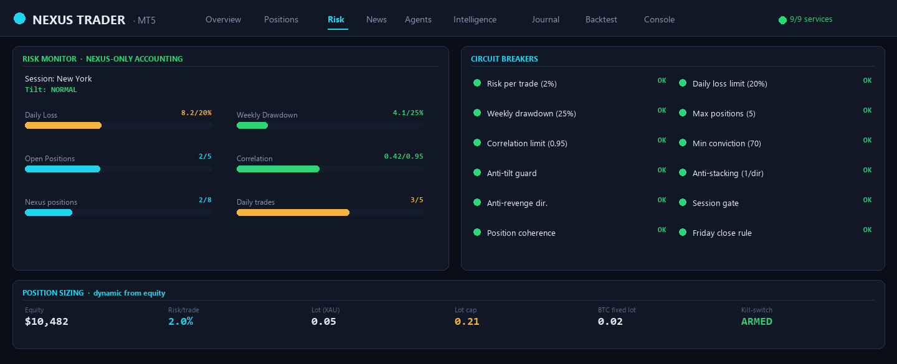
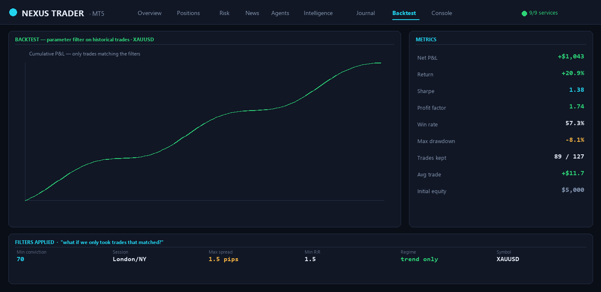

<div align="center">

# 🛰️ Nexus Trader — MT5

### Autonomous, multi-agent **AI trading system** for **XAUUSD (Gold)** & **BTCUSD** on MetaTrader 5

**A 9-microservice engine that fuses a quantitative ML ensemble, a Generative-AI multi-agent debate, reinforcement learning and a live behavioral risk manager — reasoning over real market structure and executing on MT5.**

📄 [**Español**](README.es.md) &nbsp;·&nbsp; ⚖️ AGPL-3.0 &nbsp;·&nbsp; 🐍 Python 3.11+ &nbsp;·&nbsp; ⚛️ Next.js 14


</div>

---

> ⚠️ **Disclaimer.** This is a research and portfolio project. Trading leveraged instruments (Gold, crypto CFDs) carries substantial risk of loss. The repository ships **no credentials** and connects to a **demo account** by default. Nothing here is financial advice. Use at your own risk.

---

## 📚 Documentation

| Guide | What's inside |
|-------|---------------|
| **[This README](README.md)** | Architecture, AI stack, how it trades, setup |
| **[README en Español](README.es.md)** | Full Spanish translation |
| **[.env.example](.env.example)** | Every configuration knob, documented |

---

## 🎯 What it actually is

Nexus Trader is a **fully autonomous trading brain** built as **9 cooperating microservices**. It does not run a single indicator strategy — it runs a *pipeline of specialists* that argue their way to a decision, exactly like a real trading desk:

1. **Quant desk** — a machine-learning ensemble (gradient boosting + deep sequence models + anomaly detection) votes on direction, volatility regime and SL/TP.
2. **Research desk** — Generative-AI agents (a *bull* and a *bear*) debate the trade, and an **arbitrator** agent issues the verdict with a conviction score.
3. **Risk desk** — a live rules engine + behavioral *anti-tilt* guard sizes the position and can veto anything, no matter how confident the desk is.
4. **Execution desk** — a smart router places the order on MT5 with slippage/spread controls and a global kill-switch.

Everything is **event-driven over Redis streams**, **dynamically configured** (no magic numbers hardcoded — limits live in Redis and are editable from the dashboard), and **multi-asset** (separate ML models per symbol: Gold behaves nothing like Bitcoin).

---

## 🧠 The two layers of AI (and why there are two)

Most "AI trading bots" are one model. Nexus deliberately stacks **two complementary kinds of intelligence**, because they fail in different ways:

```mermaid
flowchart LR
    subgraph Q["🔢 Quantitative AI  ·  fast, numeric, backtestable"]
        direction TB
        Q1[XGBoost — direction]
        Q2[LightGBM — regime + SL/TP]
        Q3[LSTM — sequence memory]
        Q4[Isolation Forest — anomaly]
        Q5[HMM — hidden regime states]
    end
    subgraph G["💬 Generative AI  ·  contextual reasoning + narrative"]
        direction TB
        G1[Bull Researcher]
        G2[Bear Researcher]
        G3[Arbitrator — final verdict]
        G4[News Sentinel + FinBERT]
    end
    Q -->|numeric votes + confidence| G
    G -->|reasoned verdict + conviction| R[⚖️ Risk Manager]
    R --> E[⚡ Executor → MT5]
```



- **Quantitative AI** is precise and backtestable but blind to context (it can't read a central-bank headline).
- **Generative AI** reads context, weighs conflicting evidence and *explains itself* — but hallucinates and can't measure probabilities.
- The **arbitrator** fuses both, and the **risk manager** has the final, non-overridable veto.

---

## 🏗️ System architecture



Services never call each other directly for market data — they **publish and subscribe to Redis streams**, so any service can crash and restart without taking the pipeline down. `run.py` is a supervisor that boots all 9 services + the dashboard, injects inter-service URLs, and auto-restarts crashes.

---

## 🔄 How a trade is actually made (the decision cycle)



The LangGraph agent pipeline runs these nodes in order:
`session_check → regime_analysis → parallel_analysis → parallel_debate → arbitrator → risk_check → execute → position_manage → portfolio_review`.

---

## 🔬 Frontier techniques used (the "valuable knowledge" part)

This is where quant meets modern ML. Nexus combines, in one system:

| Technique | Where | Why it matters |
|-----------|-------|----------------|
| **Multi-timeframe fusion** | features | M1→D1 flattened into one vector so the model sees micro + macro structure at once |
| **Volatility-regime detection** | HMM + LightGBM | Strategy adapts to *trend / range / high-vol* instead of one-size-fits-all |
| **Cross-asset signals** | features | Gold is priced against **DXY** (USD) and **US10Y** real yields; BTC vs risk appetite |
| **Gradient-boosted ensemble** | XGBoost + LightGBM | Direction + SL/TP regression, per symbol, walk-forward validated |
| **Deep sequence memory** | LSTM (PyTorch) | Captures path-dependency a tree model can't |
| **Anomaly detection** | Isolation Forest | Flags abnormal market states → suppress trading |
| **GenAI multi-agent debate** | LangGraph + DeepSeek | Bull/bear adversarial reasoning + an arbitrator that must justify the verdict |
| **News sentiment** | FinBERT + LLM | Economic-calendar impact scoring and pre-news **blackout windows** |
| **Reinforcement learning** | PPO (PyTorch) | A *lifecycle* agent manages each open position bar-by-bar — hold / trail / move-to-breakeven / take-partial / exit |
| **Autonomous strategy R&D** | research registry | GenAI proposes strategies; they're backtested and promoted/retired by rule-based thresholds |
| **Behavioral risk** | anti-tilt engine | Consecutive-loss & revenge-trade guards — the psychology layer most bots ignore |
| **Shadow trades** | risk + memory | Rejected signals are tracked counterfactually to measure the cost of caution |
| **Trade memory** | DuckDB | Per-hour / per-session / per-regime win-rates feed *dynamic* thresholds |
| **Walk-forward + auto-retrain** | nexus-ml | Models retrain on fresh data and never look ahead |

---

## 🤖 The ML ensemble (nexus-ml)

Each **symbol** keeps its own trained models under `models_store/<SYMBOL>/` — Gold and Bitcoin get completely separate brains.

| Model | File | Role |
|-------|------|------|
| **XGBoost** | `xgboost_direction.py` | Primary UP/DOWN classifier with calibrated probability |
| **LightGBM** | `lightgbm_regime.py` | Volatility-regime class + SL/TP pip regression |
| **LSTM** | `lstm_sequence.py` | Sequence model for path-dependent momentum |
| **Random Forest** | `random_forest_features.py` | Feature-importance & robustness vote |
| **Isolation Forest** | `isolation_anomaly.py` | Unsupervised anomaly / regime-break detector |
| **HMM** | `hmm_regime.py` | Hidden-Markov hidden-state regime labeling |
| **FinBERT** | `finbert_sentiment.py` | Transformer news-sentiment scoring |

Votes are aggregated in `ensemble.py`; `auto_retrain.py` schedules retraining; `trade_memory.py` (DuckDB) supplies the adaptive context.

---

## 🧑‍💼 The agent desk (nexus-agents)

A LangGraph state machine of specialist agents (GenAI via **DeepSeek**, OpenAI-compatible):

| Agent | Role |
|-------|------|
| **Session Governor** | Is this session (Tokyo/London/NY/Sydney) tradable? Adapts, never hard-blocks |
| **Regime Analyst** | Classifies the current market regime for the debate |
| **Market Analyst / Order Flow / Intermarket** | Read structure, flow and cross-asset context |
| 🐂 **Bull Researcher** vs 🐻 **Bear Researcher** | Adversarial debate — each argues its side |
| ⚖️ **Arbitrator (A7)** | Final verdict + conviction score, must justify it |
| 🛡️ **Risk Manager (A8)** | Non-overridable veto + sizing |
| **Portfolio Strategist / Position Manager** | Portfolio-level coherence and open-trade management |
| **News Sentinel** | Economic-calendar impact + blackout windows |

The **Research** module (`research/researcher.py`, `evaluator.py`, `registry.py`) autonomously proposes, backtests and promotes/retires strategies via **rule-based thresholds** (statuses: active / backtested / investigating / rejected). Separately, a **PPO lifecycle agent** (`nexus_ml/traders/rl_lifecycle.py`, PyTorch) manages each *open position* bar-by-bar — hold, trail, move-to-breakeven, take-partial or exit.

---

## ⚖️ The risk system (nexus-risk) — the part that keeps you solvent

Risk is a **first-class service**, not an afterthought. Limits are **inviolable minimums** clamped in code and **live-editable** above that from the dashboard.

- **Circuit breakers**: daily-loss (default **20%**), weekly drawdown (**25%**), max positions, correlation cap, daily-trade cap, min conviction, min risk:reward.
- **Anti-tilt engine**: tracks consecutive losses, enforces cooldowns, and blocks *revenge trading* and same-direction *stacking*.
- **Nexus-only accounting**: on a shared MT5 account, only trades placed by Nexus count toward its limits — external/manual trades never trip the breaker.
- **Dynamic position sizing**: lots scale from equity (with a hard ceiling); BTC uses a fixed lot.
- **Global kill-switch**: the executor checks it before every order.

---

## 📊 Dashboard

A real-time **Next.js 14** control room (tabs: *Overview, Positions, Risk, News, Agents, Intelligence, Journal, Backtest, Console*) streaming over WebSockets + SSE: live session clock, ML pipeline status, the A7 arbitrator's reasoning, the risk monitor with every circuit breaker, correlation matrix, cross-asset panel and a backtest runner.

**Overview** — live P&L, market regime, the A7 decision with conviction, session clock and open positions:


**Intelligence** — the ML ensemble votes, the bull/bear agent debate, cross-asset, correlation matrix and the PPO strategy lifecycle:


**Agents** — the LangGraph pipeline, the bull vs bear reasoning and the arbitrator's verdict:


**Risk Monitor** — every circuit breaker, the daily-loss (20%) and drawdown gauges, anti-tilt and dynamic sizing:


**Backtest** — a parameter-filter backtest over your historical closed trades (WR, PF, Sharpe, max drawdown) with a cumulative-P&L curve:


---

## 🧰 Tech stack

**Backend** · Python 3.11+ · FastAPI · Pydantic v2 · Redis (streams + cache) · DuckDB
**ML/AI** · XGBoost · LightGBM · PyTorch (LSTM + custom PPO) · scikit-learn · hmmlearn · LangChain / LangGraph · **DeepSeek / OpenAI (GPT) / Gemini** (selectable) · FinBERT
**Market** · MetaTrader5 · pandas-ta
**Frontend** · Next.js 14 (App Router) · React · TypeScript · Tailwind · TanStack Query · WebSockets/SSE
**Infra** · Redis (Docker) · a Python supervisor (`run.py`) that boots and heals the whole fleet

---

## ✅ Prerequisites

- **Python 3.11+** and a virtual environment
- **Node.js 18+** (dashboard)
- **Docker Desktop** (for Redis) — or a local Redis on `:6379`
- **MetaTrader 5** terminal installed & logged in (a **demo** account is perfect)
- Optional: a **DeepSeek** API key for the GenAI agents (the quant ensemble runs without it)

---

## 🚀 Setup & run

```bash
# 1. Clone
git clone https://github.com/MirandaCR/Nexus-Trading-System-MT5.git
cd Nexus-Trading-System-MT5

# 2. Python env + deps
python -m venv .venv
# Windows: .venv\Scripts\activate   ·   macOS/Linux: source .venv/bin/activate
pip install -r requirements.txt

# 3. Dashboard deps
cd dashboard && npm install && cd ..

# 4. Configuration — copy the template and fill in YOUR values
cp .env.example .env
#   → set MT5_LOGIN / MT5_PASSWORD / MT5_SERVER (demo account)
#   → optional: DEEPSEEK_API_KEY for the GenAI agents

# 5. Start Redis (Docker)
docker run -d --name nexus-redis -p 6379:6379 redis:7-alpine

# 6. Launch the whole fleet (9 services + dashboard) with pre-flight checks
python run.py
```

Then open **http://localhost:3100**. `run.py` runs a pre-flight (env, Redis, MT5 connectivity, models) and refuses to start if something critical is missing.

---

## ⚙️ Configuration

Everything is driven by `.env` (see **[.env.example](.env.example)** for the fully-documented list). Highlights:

| Variable | Meaning |
|----------|---------|
| `MT5_LOGIN` / `MT5_PASSWORD` / `MT5_SERVER` | Your MT5 **demo** credentials (never commit them) |
| `STREAM_SYMBOLS` | Symbols to trade, e.g. `XAUUSD,BTCUSD` |
| `NEXUS_TRADING_MODE` | `live` / paper behavior |
| `NEXUS_LLM_PROVIDER` | **Which AI powers the agents** — `deepseek` (default), `openai` (GPT), `gemini`, or `local` |
| `DEEPSEEK_API_KEY` / `OPENAI_API_KEY` / `GEMINI_API_KEY` | Key for the selected provider (only one needed) |
| `NEXUS_FIXED_LOTS` | Per-symbol fixed lot (e.g. `BTCUSD=0.02`) |
| `NEXUS_LOG_JSON` | `false` = readable console logs, `true` = JSON for prod |

> 🧠 **Pick your AI.** The GenAI agents run on **DeepSeek** by default, but you can switch to **OpenAI (GPT)** or **Google Gemini** with a single env var — all three use OpenAI-compatible endpoints, so no extra dependencies. The quantitative ML ensemble runs regardless of provider.

Runtime risk limits (daily loss, positions, conviction…) live in **Redis** and are editable from the dashboard **Settings** — no redeploy needed.

---

## 🗂️ Project structure

```
nexus-trader/
├── run.py                 # supervisor: boots & heals all services + dashboard
├── preflight.py           # startup safety checks
├── config/                # risk_rules.yaml + strategy configs
├── shared/                # models, Redis client, logger, runtime settings
├── services/
│   ├── nexus_api/         # gateway / BFF + WebSockets  (:9000)
│   ├── nexus_data/        # MT5 ingestion (isolated worker) (:9001)
│   ├── nexus_features/    # MTF + cross-asset + correlation (:9002)
│   ├── nexus_ml/          # ensemble, models, traders, RL (:9003)
│   ├── nexus_agents/      # LangGraph agents, research, RL lifecycle (:9004)
│   ├── nexus_news/        # calendar + sentiment (:9005)
│   ├── nexus_risk/        # circuit breakers + anti-tilt (:9006)
│   ├── nexus_executor/    # MT5 execution + kill-switch (:9007)
│   └── nexus_monitor/     # health + telemetry (:9008)
├── dashboard/             # Next.js 14 control room (:3100)
├── models_store/          # per-symbol trained models (git-ignored)
└── docs/                  # documentation + screenshots
```

---

## ⚠️ Honest limitations

- Live P&L depends on a **running, logged-in MT5 terminal** with *Algo Trading* enabled.
- The GenAI agents need a DeepSeek key; without it the system still trades on the quant ensemble.
- ML models retrain on your data — out-of-the-box weights are a starting point, not a guarantee.
- This is a **portfolio / research** system, not a turnkey money printer. Markets change; past performance ≠ future results.

---

## 🤝 Contributing

Issues and PRs welcome. Because this is **AGPL-3.0**, any hosted/derived version must also publish its source.

## ⚖️ License

Licensed under the **GNU Affero General Public License v3.0** — see [LICENSE](LICENSE).
The AGPL's network clause means if you run a modified version as a service, you must offer its source to your users.

---

<div align="center">

*Built as a portfolio project by [@MirandaCR](https://github.com/MirandaCR) — combining quantitative finance, modern ML and applied Generative AI.*

</div>
